# Documento técnico: 22 patrones de diseño en AccountingLab

Este documento explica cómo se resolvió cada desafío (DP-01 a DP-22): el problema, las clases, cómo cumple SOLID, los límites y las pruebas. Los diagramas UML están en Mermaid y se ven directo en GitHub.

## Decisiones comunes

- **Contratos.** Cada desafío sigue exponiendo su clase `XxxChallenge` con constructor sin parámetros, que usan las pruebas y el controlador. Ahora esa clase es el cliente del patrón. Los participantes viven en el mismo `Challenge.cs` de cada carpeta.
- **Capas.** En Domain están DP-01, 02, 04, 05, 08, 11, 13, 14, 16 a 20 y 22. En Application, DP-03, 07, 09, 10, 12, 15 y 21. El Adapter (DP-06) está en Infrastructure porque conoce formatos JSON de bancos. Domain no depende de capas externas y las pruebas de arquitectura lo comprueban.
- **Importes.** `decimal` con máximo cuatro decimales. La validación y el redondeo (hacia afuera del cero) están en una sola clase, `MoneyPrecision`, en Domain/Model.
- **Excepciones.** Las entradas inválidas lanzan `ArgumentException` simple, porque `Assert.Throws<T>` exige el tipo exacto. La excepción es la tolerancia negativa de DP-21, que pide `ArgumentOutOfRangeException`.
- **HTTP.** En los endpoints de los desafíos, el controlador traduce `ArgumentException`, `FormatException` e `InvalidOperationException` a 400 y `UnauthorizedAccessException` a 403. Un `PatternPendingException` seguiría dando 501.

---

## DP-01 Factory Method

**Problema y patrón.** Hay que generar comprobantes de ingreso, egreso, ajuste y traslado, y vendrán más tipos. Factory Method deja la validación común en el creador y la decisión de qué crear en un solo método que cada creador redefine.

**Clases.** `Voucher` es el producto, con cuatro variantes concretas. `VoucherCreator.Create` valida y llama a `CreateVoucher`, que redefinen los cuatro creadores. `VoucherCreationChallenge` busca el creador en un diccionario, sin `if` ni `switch`.

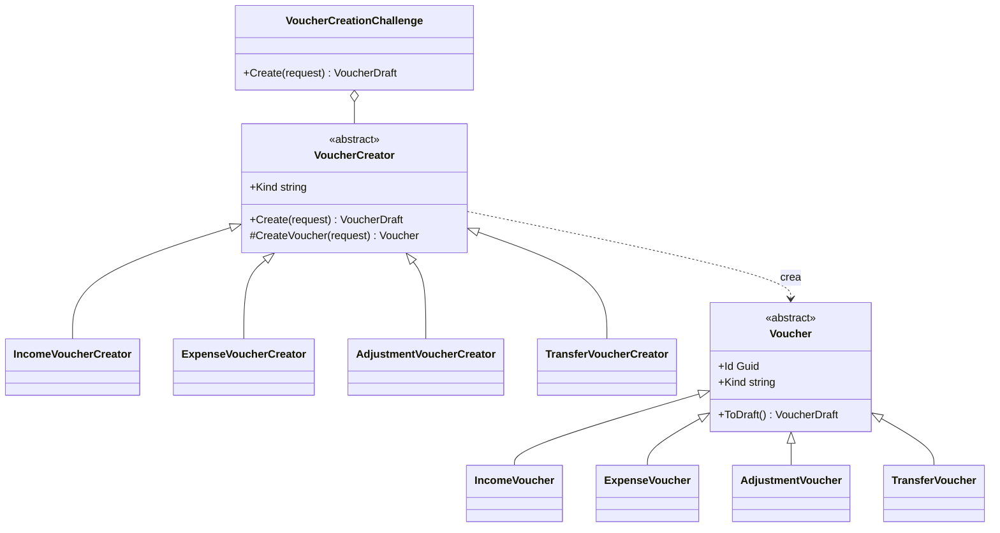

**SOLID.** Un tipo nuevo es un producto, un creador y una línea de registro; no se toca lo existente.

**Límites.** Hoy los cuatro productos solo cambian de nombre, así que son muchas clases para poco. Se justifican si cada tipo gana reglas propias.

**Pruebas.** Tres: valores conservados con id nuevo, tipo desconocido rechazado y los cuatro tipos con importe cero.

---

## DP-02 Abstract Factory

**Problema y patrón.** Cada empresa necesita tres servicios compatibles entre sí (cálculo, validación y reporte) según perfil y régimen. Abstract Factory garantiza que los tres salgan de la misma fábrica y compartan clave de compatibilidad.

**Clases.** `AccountingServiceFactory` declara `CreateCalculation`, `CreateValidation` y `CreateReport`. `CommercialServiceFactory` y `ServicesServiceFactory` producen cada una su familia (seis productos, clave `perfil/régimen`). `AccountingProfileChallenge` elige la fábrica y solo usa las abstracciones.

```mermaid
classDiagram
    class AccountingServiceFactory {
        <<abstract>>
        +Profile string
        +Regime string
        +CreateCalculation() CalculationService
        +CreateValidation() ValidationService
        +CreateReport() ReportService
    }
    class CommercialServiceFactory
    class ServicesServiceFactory
    class AccountingService {
        <<abstract>>
        +Role string
        +CompatibilityKey string
    }
    class CalculationService { <<abstract>> }
    class ValidationService { <<abstract>> }
    class ReportService { <<abstract>> }
    AccountingServiceFactory <|-- CommercialServiceFactory
    AccountingServiceFactory <|-- ServicesServiceFactory
    AccountingService <|-- CalculationService
    AccountingService <|-- ValidationService
    AccountingService <|-- ReportService
    CommercialServiceFactory ..> CalculationService
    CommercialServiceFactory ..> ValidationService
    CommercialServiceFactory ..> ReportService
    ServicesServiceFactory ..> CalculationService
    ServicesServiceFactory ..> ValidationService
    ServicesServiceFactory ..> ReportService
```

**SOLID.** Un perfil nuevo es una fábrica nueva; el cliente no cambia.

**Límites.** Es el patrón con más clases por funcionalidad, y añadir un cuarto servicio obliga a tocar todas las fábricas. Los productos son marcadores sin comportamiento real.

**Pruebas.** Tres: roles en orden con una clave, perfil inexistente rechazado y perfiles distintos con claves distintas.

---

## DP-03 Builder

**Problema y patrón.** Un informe se arma con título, periodo, secciones y anexos, casi todo opcional. Builder lo construye por pasos y valida el conjunto al final, así que nunca existe un informe a medias.

**Clases.** `IFinancialReportBuilder` define los pasos. `FinancialReportBuilder` acumula y valida en `Build` (título obligatorio, intervalo presente y no invertido) y se vacía para reutilizarse. `FinancialReportDirector` conoce el orden y `ReportAssemblyChallenge` los une.

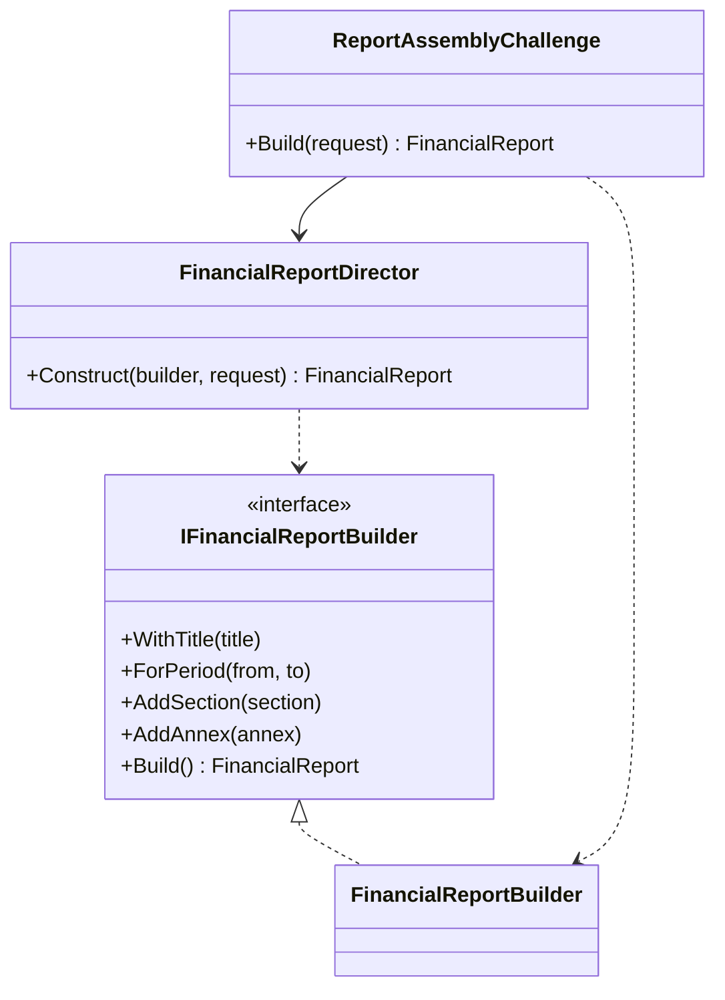

**SOLID.** El director depende de la interfaz, así que otro constructor entra sin cambiarlo.

**Límites.** Para cinco campos es más estructura de la necesaria. Se aceptan secciones vacías y repetidas.

**Pruebas.** Tres: secciones, anexos y fechas conservados, intervalo invertido rechazado e informe mínimo.

---

## DP-04 Prototype

**Problema y patrón.** Las plantillas recurrentes se duplican, y una copia superficial compartiría renglones y etiquetas con el original. Prototype hace que cada objeto sepa copiarse en profundidad.

**Clases.** `IPrototype<T>` declara `Clone`. `TemplateLine` copia sus etiquetas y `RecurringTemplate` clona cada renglón. `TemplateCopyChallenge.Copy` rechaza la fuente nula y asigna un id nuevo, porque la copia es otro documento.

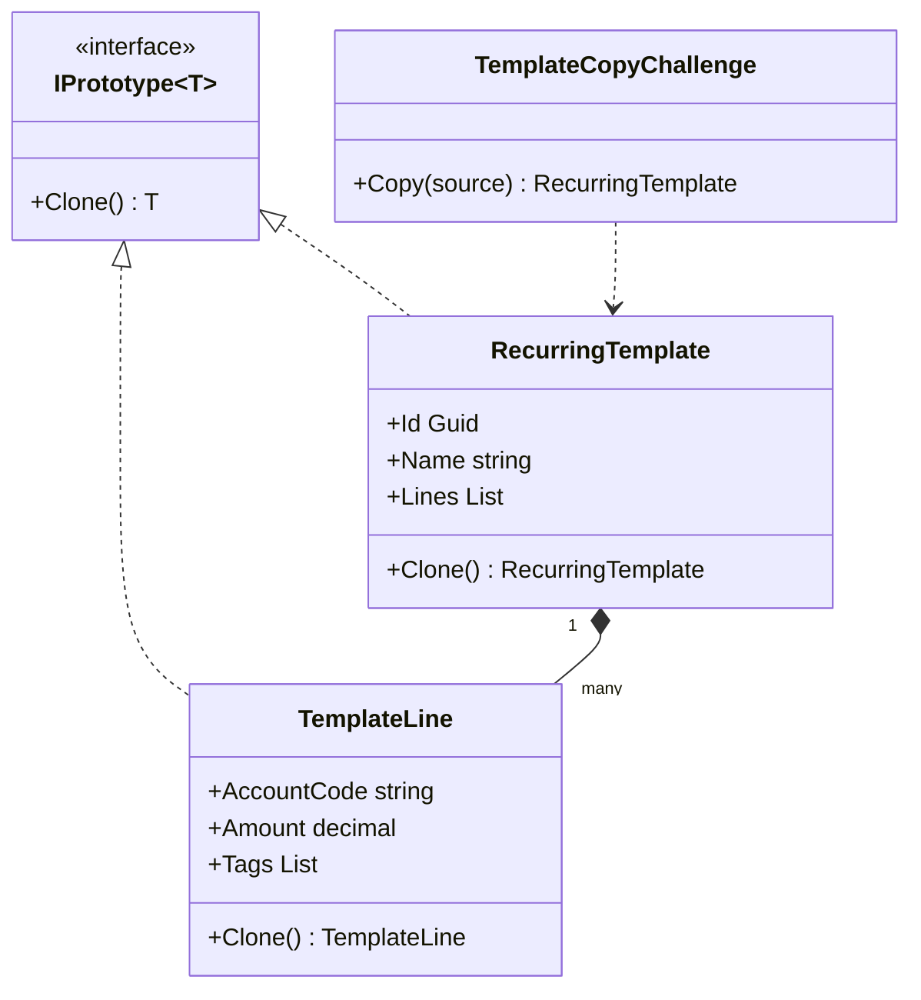

**SOLID.** Cada clase responde por su copia; el cliente no sabe cuántos niveles hay.

**Límites.** Un campo mutable nuevo obliga a acordarse de actualizar `Clone`, y solo lo cubre la prueba de independencia.

**Pruebas.** Tres: valores con identidad propia, fuente nula rechazada y etiquetas y renglones independientes del original.

---

## DP-05 Singleton

**Problema y patrón.** Debe haber un único registro global inmutable (`DEMO-1`, escala 4, ámbito `process`) y visible igual desde varios hilos. La inyección de dependencias sola no lo garantiza; Singleton sí.

**Clases.** `GlobalRegistryHolder` es una clase estática interna con un campo `static readonly`: el CLR lo inicializa una vez y de forma segura entre hilos, sin bloqueos. `GlobalAccountingRegistry` es un `record` inmutable y `GlobalRegistryChallenge.Acquire` devuelve siempre esa instancia.

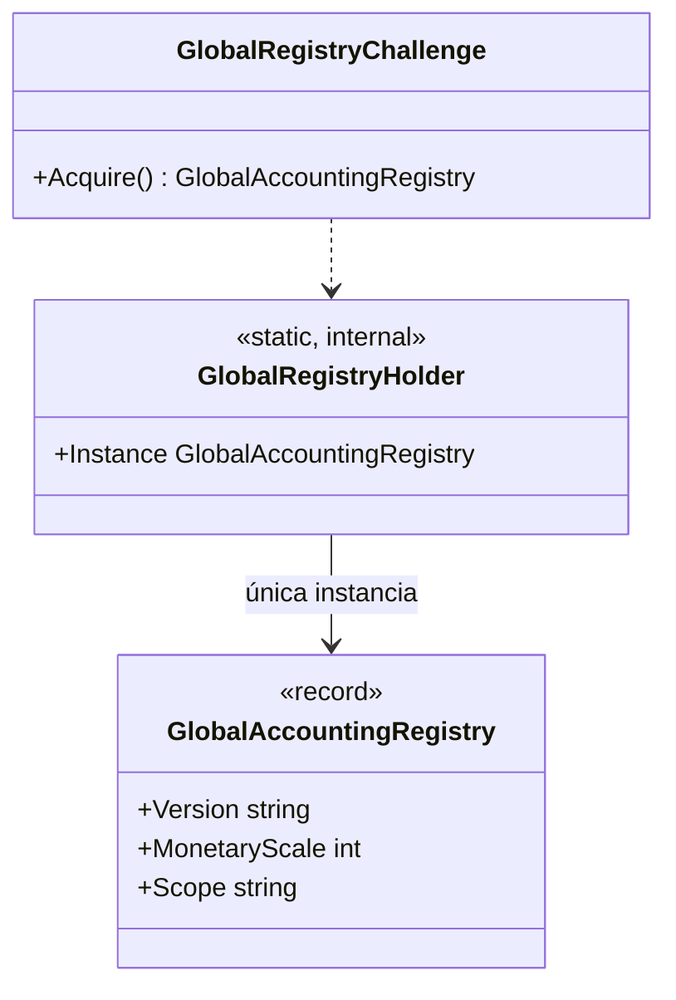

**SOLID.** El estado global choca con la inversión de dependencias, por eso el acceso es mínimo y el contenido inmutable.

**Límites.** El `record` conserva su constructor público (lo usan las pruebas), así que alguien puede crear otra instancia a mano; la única es la que entrega el titular. Vale por proceso: con varias instancias de la API habría una por cada una.

**Pruebas.** Tres: misma identidad entre llamadas, 16 accesos concurrentes y copia independiente con `with`.

---

## DP-06 Adapter

**Problema y patrón.** Dos bancos ficticios entregan JSON con campos, fechas e importes distintos (en BancoB, un importe negativo es débito). Adapter los traduce a un modelo común, `ImportedBankMovement`, sin tocar el contrato de cada banco.

**Clases.** `IBankStatementAdapter` es la interfaz. `BancoAAdapter` y `BancoBAdapter` convierten `BancoALine` y `BancoBLine`. `ProviderJson` lee el JSON de forma estricta y convierte cualquier anomalía en `FormatException`. `BankImportChallenge` elige el adaptador por proveedor.

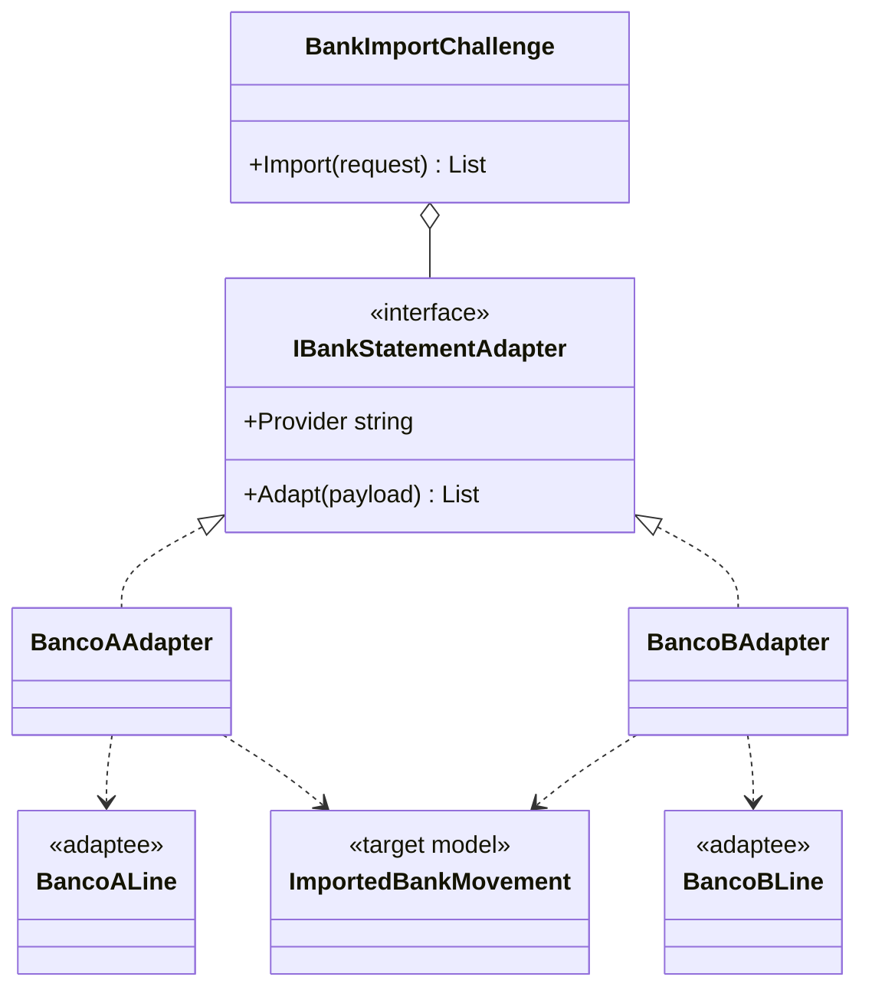

**SOLID.** Un tercer banco es un adaptador nuevo. Está en Infrastructure porque conoce formatos externos.

**Límites.** Hay un adaptador por proveedor, y si el banco cambia su JSON se rompe. Se rechaza cualquier importe con más de cuatro decimales.

**Pruebas.** Tres: BancoA con decimales exactos, JSON inválido (`FormatException`) y BancoB con importes negativos y cero.

---

## DP-07 Bridge

**Problema y patrón.** Los reportes (balance, resultados) y sus formatos (JSON, CSV) varían por separado; con herencia habría una clase por combinación. Bridge separa los dos ejes y los une por composición.

**Clases.** `IReportRepresentation`, con `JsonReportRepresentation` y `CsvReportRepresentation`, es el implementador. `FinancialReportView` guarda una representación y delega en ella; `BalanceReportView` e `IncomeStatementReportView` son las variantes. `FinancialRepresentationChallenge` combina cualquiera con cualquiera.

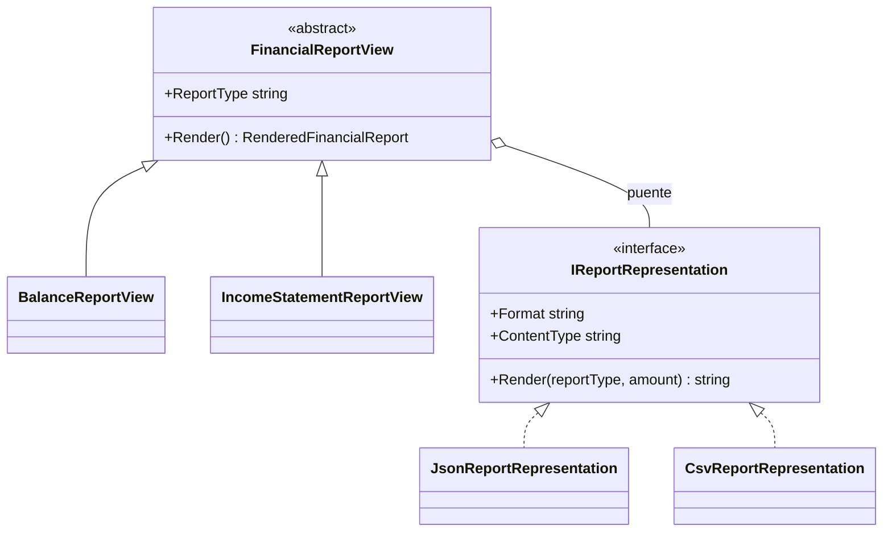

**SOLID.** Un formato nuevo no toca los reportes, y un reporte nuevo no toca los formatos.

**Límites.** Con dos y dos la ganancia es pequeña. Los importes salen como texto con cuatro decimales, igual que en HTTP.

**Pruebas.** Tres: las cuatro combinaciones, formato desconocido rechazado y cero exacto en JSON.

---

## DP-08 Composite

**Problema y patrón.** El catálogo mezcla cuentas de movimiento y agrupadoras, y ambas deben responder igual a «¿cuál es tu saldo?». Composite las trata con la misma interfaz.

**Clases.** `AccountNode.Total()` es el componente. `PostingAccountNode` es la hoja y `AccountGroupNode` suma a sus hijos, sin saldo propio. `AccountNodeFactory` arma el árbol y rechaza una cuenta de movimiento con subcuentas.

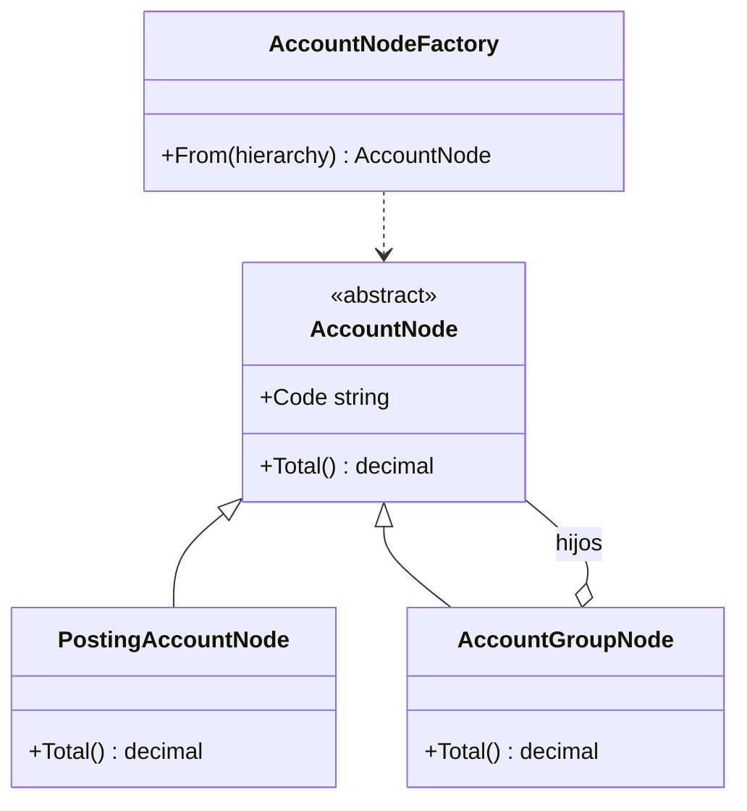

**SOLID.** El cliente no distingue hoja de grupo, y un nodo nuevo no cambia la suma.

**Límites.** Una agrupadora ignora su `OwnBalance` aunque venga distinto de cero. Un árbol muy profundo se recorre por recursión.

**Pruebas.** Tres: totales anidados (100.1250), cuenta de movimiento con hijos rechazada y grupo vacío en cero.

---

## DP-09 Decorator

**Problema y patrón.** La exportación admite extras combinables (marca de auditoría y metadatos), y una subclase por combinación se dispara. Decorator envuelve el exportador y añade cada extra en el orden pedido.

**Clases.** `IDocumentExport` es el componente y `PlainDocumentExport` el documento base. `AuditMarkDecorator` añade `[AUDIT]` y `MetadataDecorator` los metadatos. `DocumentEnrichmentChallenge` arma la cadena desde una tabla y rechaza características desconocidas o repetidas.

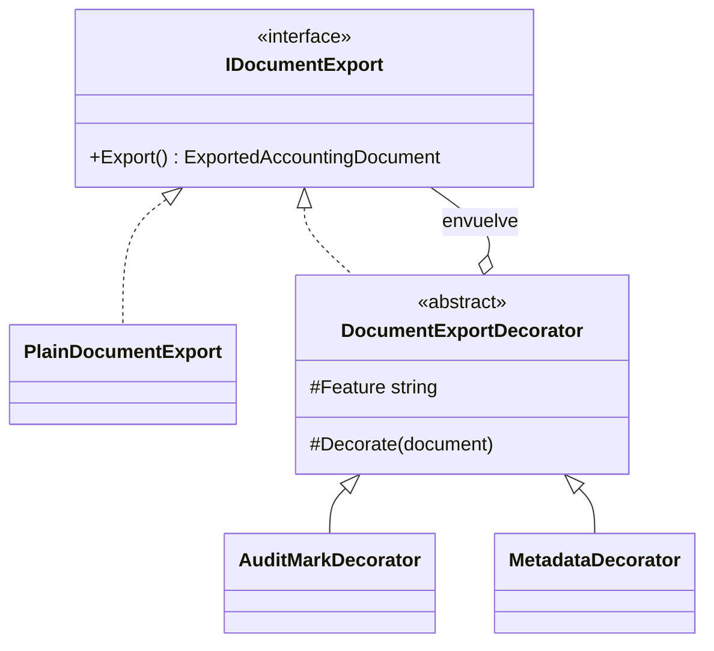

**SOLID.** Una característica nueva es un decorador y una línea en la tabla.

**Límites.** Los metadatos solo salen si se pide `metadatos`, aunque la solicitud los traiga. Hoy el orden no altera el resultado, porque cada decorador solo añade.

**Pruebas.** Tres: ambas características con el cuerpo intacto, característica desconocida rechazada y exportación sin extras idéntica al original.

---

## DP-10 Facade

**Problema y patrón.** Cerrar un periodo exige comprobar que no queden documentos sin contabilizar y que los saldos cuadren. Facade ofrece una sola operación, `Close`, y esconde las comprobaciones.

**Clases.** `PendingDocumentsCheck` y `BalanceConsistencyCheck` hacen cada comprobación. `PeriodClosingChallenge` es la fachada: las ejecuta en orden y arma el resumen. Si algo falla no hay resumen; no existe un cierre parcial.

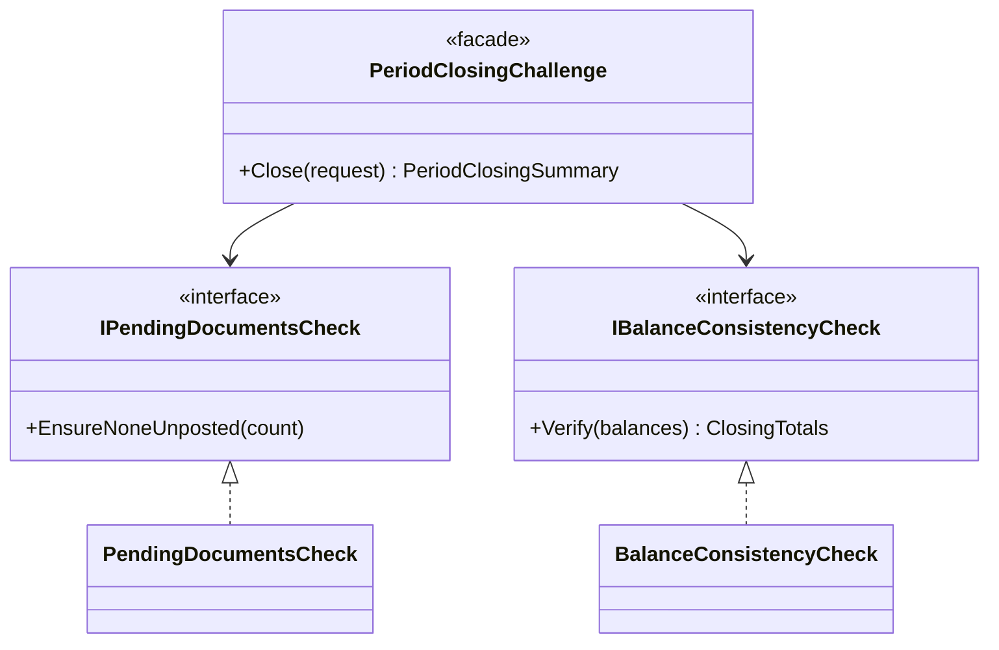

**SOLID.** Depende de interfaces, inyectadas por un segundo constructor.

**Límites.** Trabaja con datos ya calculados que llegan en la solicitud y no persiste nada. El riesgo clásico es que la fachada crezca hasta hacerlo todo.

**Pruebas.** Tres: periodo consistente con totales, documentos sin contabilizar rechazados y desbalance mínimo (0.0001) rechazado.

---

## DP-11 Flyweight

**Problema y patrón.** Un lote grande de movimientos repite los mismos metadatos de clasificación. Flyweight comparte lo inmutable y guarda aparte lo propio de cada movimiento (id e importe).

**Clases.** `ClassificationMetadata` es un `record` inmutable y `ClassifiedMovement` guarda su estado y una referencia a esos metadatos. `ClassificationFlyweightFactory` mantiene un `ConcurrentDictionary` con clave (código, etiqueta, ámbito) y entrega siempre la misma instancia.

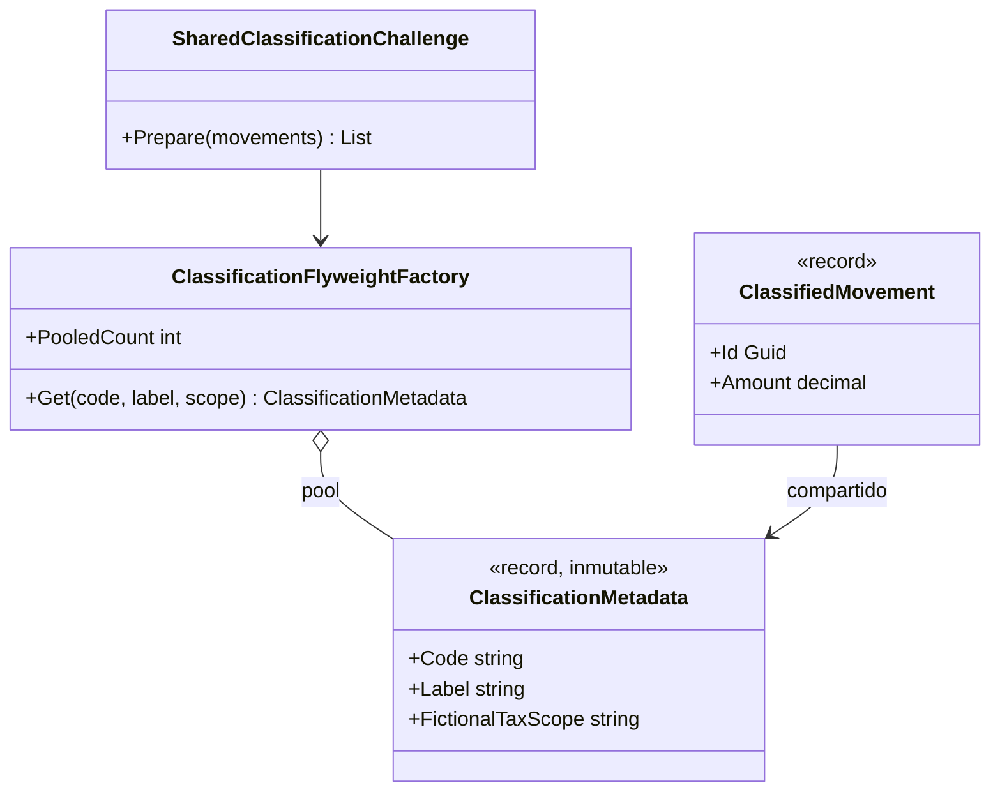

**SOLID.** La fábrica solo reutiliza y el objeto compartido no cambia.

**Límites.** El pool crece con las clasificaciones distintas y no se limpia; se acota porque el controlador crea una instancia por solicitud. Solo ahorra con volúmenes grandes.

**Pruebas.** Tres: misma instancia para clasificaciones iguales, distintas sin mezclar e ids e importes intactos.

---

## DP-12 Proxy

**Problema y patrón.** Los reportes confidenciales solo los ve quien tiene permiso, y solo de su empresa; sin permiso, la fuente ni se lee. Un proxy de protección se pone delante con la misma interfaz.

**Clases.** `ISensitiveReport` es la interfaz común y `SensitiveReportSource` el sujeto real. `SensitiveReportAccessProxy` comprueba el permiso antes de leer (`UnauthorizedAccessException`) y la empresa del resultado después (`InvalidOperationException`).

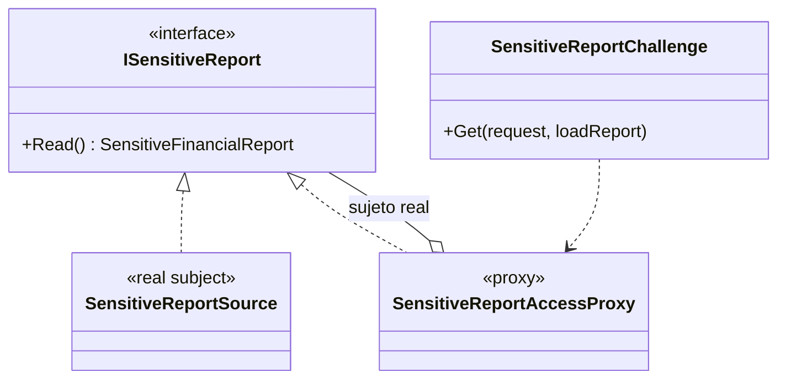

**SOLID.** La fuente no sabe de permisos y el cliente no sabe que hay un proxy. La autorización del controlador sigue intacta; el proxy es una segunda defensa.

**Límites.** El permiso llega ya calculado en `MayRead`; el proxy no autentica. En el endpoint real, el controlador lo fija tras comprobar el rol.

**Pruebas.** Tres: consulta autorizada con una sola lectura, denegada sin leer la fuente y resultado de otra empresa rechazado.

---

## DP-13 Chain of Responsibility

**Problema y patrón.** Los pagos pasan por controles configurables (fondos, política y límite), en el orden pedido, y el primero que falla rechaza. Chain of Responsibility hace de cada control un eslabón independiente.

**Clases.** `PaymentCheckHandler` aplica su control y pasa al siguiente o devuelve el rechazo, anotando lo visitado. `AvailableFundsHandler`, `PaymentPolicyHandler` y `AuthorizationLimitHandler` implementan los tres controles. `PaymentApprovalChallenge` arma la cadena según `Checks` y rechaza controles desconocidos o repetidos.

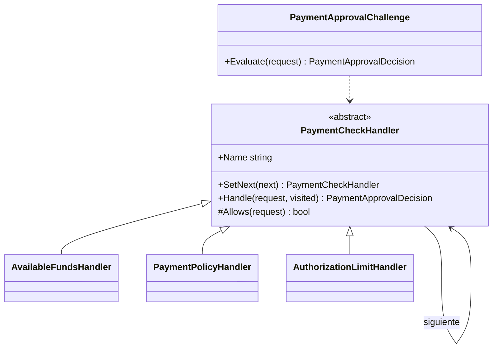

**SOLID.** Un control nuevo es una clase y una entrada en la tabla. Un importe igual al saldo o al límite se admite.

**Límites.** Sin controles configurados el pago se aprueba, lo cual en producción sería peligroso; aquí manda la solicitud. La cadena se arma en cada evaluación.

**Pruebas.** Tres: aprobación en el orden pedido, parada en el primer rechazo y límites exactos admitidos.

---

## DP-14 Command

**Problema y patrón.** Aplicar un cobro o pago, o revertir un comprobante, son operaciones identificadas que no deben duplicarse si el cliente reintenta. Command convierte cada solicitud en un objeto, y un invocador reconoce las ya ejecutadas.

**Clases.** `ApplyPaymentCommand` reduce el saldo y devuelve un asiento vinculado; `ReverseVoucherCommand` exige un objetivo publicado. `AccountingCommandFactory` crea el comando. `IdentifiedOperationChallenge` es el invocador: si el id ya se ejecutó devuelve el recibo anterior con `Replayed = true`, y si lo reutilizan con otra solicitud falla.

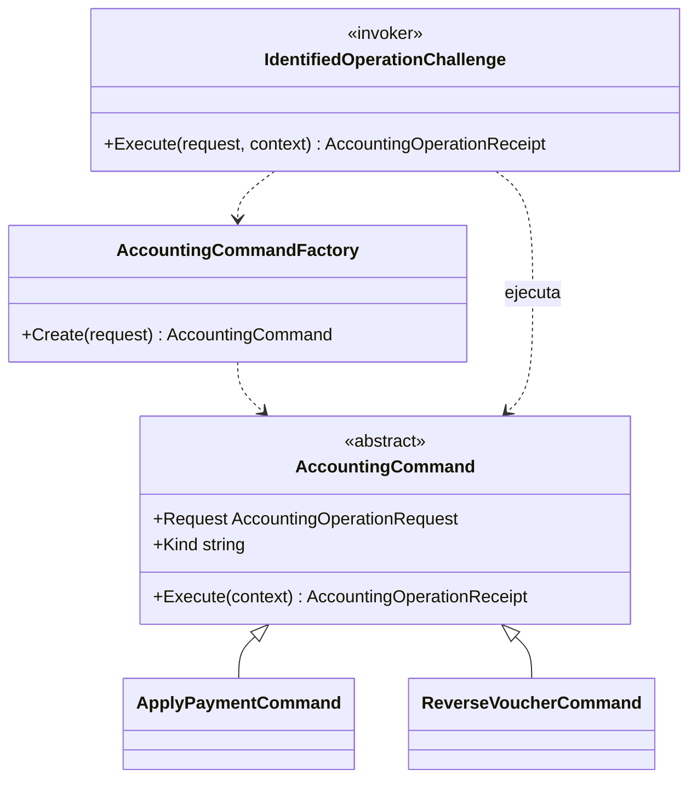

**SOLID.** Una operación nueva es un comando y un caso en la fábrica; la idempotencia vive en un solo lugar.

**Límites.** El historial llega en el contexto de la solicitud y no se guarda. Una versión real debe persistir los recibos con restricción única sobre el id, para que dos peticiones simultáneas no pasen ambas.

**Pruebas.** Tres: aplicación y reversión con vínculos, repetición que devuelve el asiento original y borrador que no se revierte.

---

## DP-15 Iterator

**Problema y patrón.** El libro llega en páginas, algunas vacías, y el consumidor quiere recorrerlo registro a registro sin saber cómo se almacena. Iterator expone solo `MoveNext` y `Current`.

**Clases.** `PagedLedgerCursor` implementa `ILedgerCursor`: trata las páginas como una sola secuencia, salta las vacías, falla en `Current` antes del primer elemento y tras el último, y sigue devolviendo falso al terminar. `LedgerTraversalChallenge.Open` lo crea.

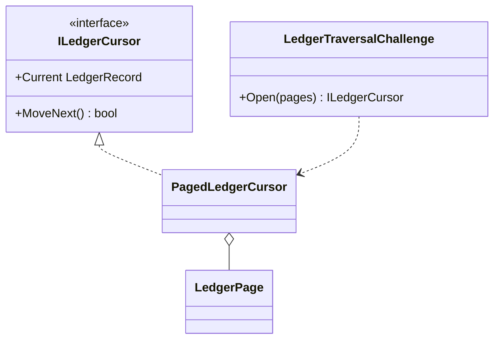

**SOLID.** El consumidor depende de la interfaz. El cursor tiene estado, así que no se comparte entre hilos.

**Límites.** Recorre las páginas sin copiarlas; si cambian durante el recorrido, cambia el resultado. El cursor no se puede serializar, así que el endpoint HTTP lo consume y devuelve la lista completa.

**Pruebas.** Tres: orden estable con una página vacía en medio, `Current` inválido fuera de posición y libro vacío.

---

## DP-16 Mediator

**Problema y patrón.** Procesar una factura implica validar, contabilizar y publicar, y si cada componente llamara al siguiente quedarían acoplados. Mediator concentra el orden y los componentes solo avisan.

**Clases.** `InvoiceComponent` es el colega base. `ValidationComponent`, `AccountingComponent` y `PublicationComponent` informan `Validated/Rejected`, `Accounted` y `Published`. `InvoiceProcessingMediator` decide quién sigue: tras `Validated` contabiliza, tras `Accounted` publica y tras `Rejected` se detiene.

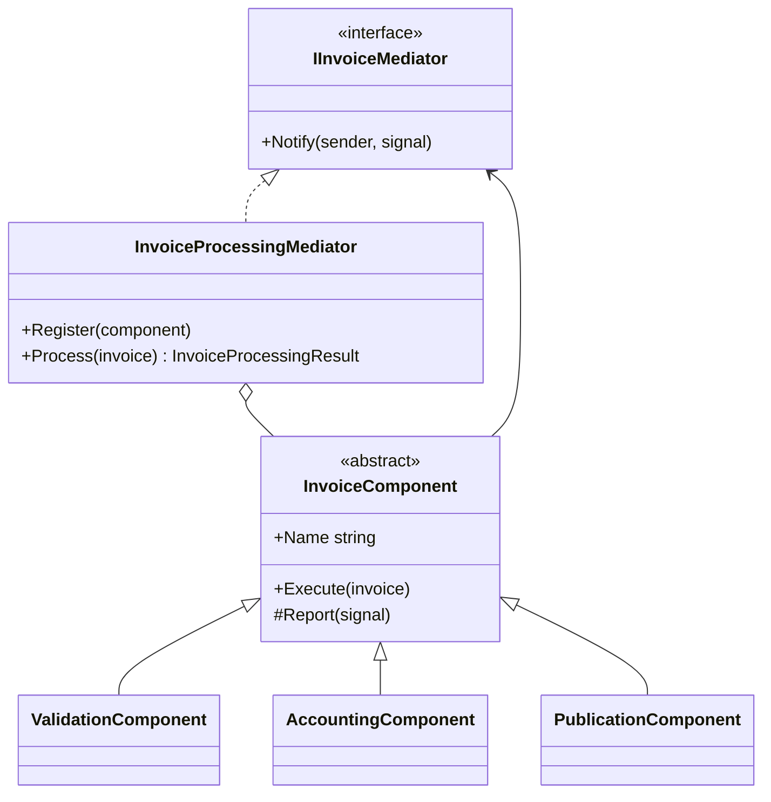

**SOLID.** Cambiar el flujo toca solo al mediador.

**Límites.** El mediador es el que más sabe y puede volverse un cuello de complejidad. Las etapas están fijas en él, y si falta un participante se salta a la siguiente. Hoy los componentes solo señalan; contabilizar y publicar de verdad exige conectarlos a servicios.

**Pruebas.** Tres: factura válida publicada con cada componente una vez, inválida solo por validación y participante repetido rechazado.

---

## DP-17 Memento

**Problema y patrón.** Los presupuestos en borrador se editan y hay que poder volver a una versión anterior; uno aprobado ya no es borrador. Memento guarda y restaura el estado sin exponerlo.

**Clases.** `BudgetDraftOriginator` crea y aplica instantáneas. Su memento es la clase privada anidada `Snapshot` (id, nombre y copia de los renglones), opaca fuera del originador. `BudgetHistoryChallenge` es el cuidador: guarda y devuelve instantáneas sin conocer su contenido. Guardar o restaurar sobre un presupuesto aprobado, o con una instantánea de otro, lanza `InvalidOperationException`.

```mermaid
classDiagram
    class BudgetDraftOriginator {
        <<originator>>
        +Save() IBudgetSnapshot
        +Restore(snapshot) BudgetDraft
    }
    class IBudgetSnapshot {
        <<interface, opaca>>
    }
    class Snapshot {
        <<private, memento>>
    }
    class BudgetHistoryChallenge {
        <<caretaker>>
        +Save(draft) IBudgetSnapshot
        +Restore(current, snapshot) BudgetDraft
    }
    IBudgetSnapshot <|.. Snapshot
    BudgetDraftOriginator +-- Snapshot : anidada
    BudgetHistoryChallenge ..> BudgetDraftOriginator
    BudgetHistoryChallenge ..> IBudgetSnapshot
```

**SOLID.** El estado queda encapsulado y el cuidador solo ve la interfaz.

**Límites.** Restaurar modifica el borrador recibido, no crea uno nuevo. Las instantáneas son copias completas y no hay almacenamiento persistente: el endpoint solo confirma que se creó.

**Pruebas.** Tres: valores restaurados con el mismo id, aprobado que no admite guardar e instantánea intacta aunque cambien los datos anidados.

---

## DP-18 Observer

**Problema y patrón.** Varios interesados (tesorería, auditoría) quieren enterarse de los hechos financieros y poder suscribirse o darse de baja. Con Observer, el publicador solo mantiene una lista y avisa.

**Clases.** `IFinancialObserver` define `Update` y `DelegateObserver` adapta una función. `FinancialEventPublisher` suscribe (rechaza identidades repetidas), da de baja y notifica una vez a cada observador, sobre una copia de la lista. `FinancialNotificationsChallenge` expone el contrato.

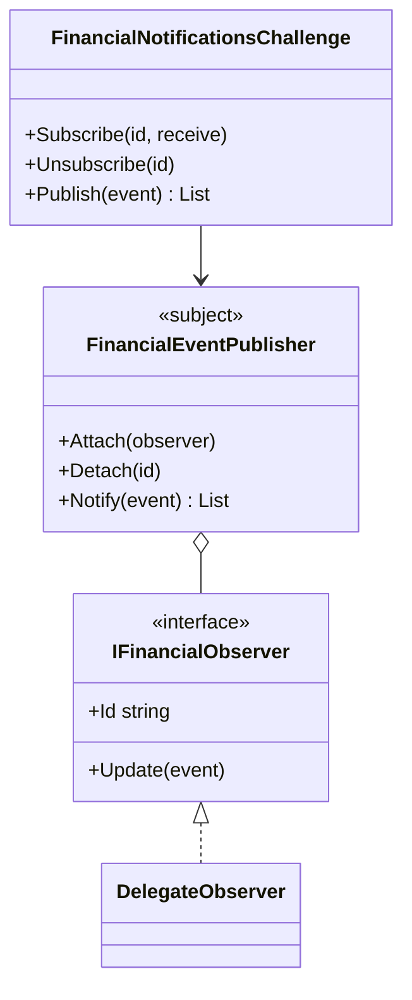

**SOLID.** El sujeto depende de la abstracción y protege su lista con un bloqueo.

**Límites.** Si un suscriptor falla, los demás igual reciben el evento y al final se lanza una `AggregateException`. Las notificaciones son síncronas: uno lento retrasa a todos. Las suscripciones viven en la instancia, por eso el botón de demostración suscribe, publica y da de baja dentro de la misma llamada.

**Pruebas.** Tres: entrega única a cada suscriptor, baja que evita entregas futuras e identidad duplicada rechazada.

---

## DP-19 State

**Problema y patrón.** Una factura pasa por `draft`, `issued`, `paid`, `cancelled` y `overdue`, y no toda acción vale en cada estado. State evita repetir un `if` por estado: cada uno sabe qué admite y adónde lleva.

**Clases.** `InvoiceState` hace fallar por defecto todas las acciones con `InvalidOperationException`, y cada estado concreto redefine solo sus transiciones válidas. `InvoiceStates` guarda una instancia por estado e `InvoiceLifecycleChallenge` es el contexto.

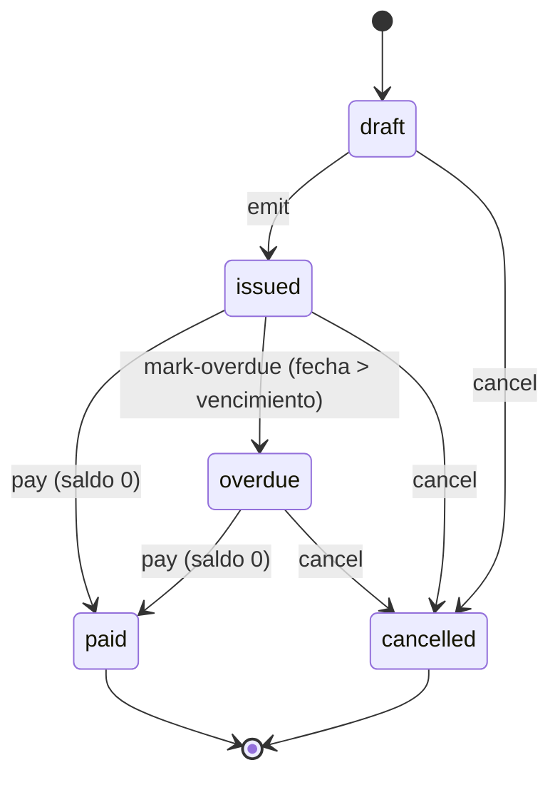

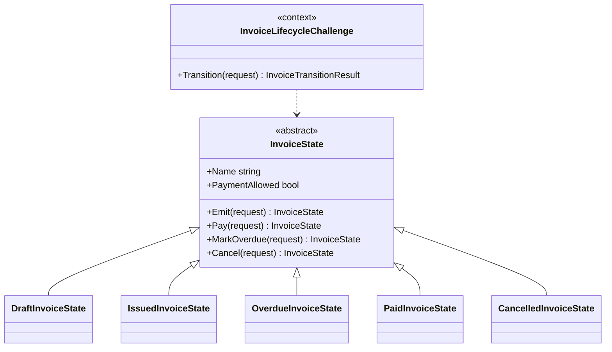

**SOLID.** Un estado nuevo es una clase, sin tocar las demás.

**Límites.** Dos decisiones propias que el enunciado no fijaba: un pago con saldo pendiente deja la factura en el mismo estado, y se puede cancelar desde `draft`, `issued` y `overdue`, pero no desde `paid`. Cambiar la regla es un cambio local.

**Pruebas.** Tres: emisión y pago por estados válidos, factura pagada que no se emite de nuevo y el límite exacto del vencimiento.

---

## DP-20 Strategy

**Problema y patrón.** El impuesto se calcula con reglas ficticias configurables (porcentaje o monto fijo) según la operación y la fecha. Strategy pone cada algoritmo detrás de una interfaz y el contexto elige.

**Clases.** `PercentageTaxStrategy` multiplica por la tasa y `FixedTaxStrategy` toma el monto, ambos redondeados a cuatro decimales hacia afuera del cero. `ConfigurableTaxChallenge` filtra las reglas vigentes (gana la de vigencia más reciente; un empate falla) y busca la estrategia por `CalculationKind`.

```mermaid
classDiagram
    class ITaxCalculationStrategy {
        <<interface>>
        +Kind string
        +Calculate(baseAmount, rule) TaxComputation
    }
    class PercentageTaxStrategy
    class FixedTaxStrategy
    class ConfigurableTaxChallenge {
        <<context>>
        +Calculate(request) TaxCalculationResult
    }
    ITaxCalculationStrategy <|.. PercentageTaxStrategy
    ITaxCalculationStrategy <|.. FixedTaxStrategy
    ConfigurableTaxChallenge o-- ITaxCalculationStrategy
```

**SOLID.** Un cálculo nuevo es una estrategia registrada en el constructor.

**Límites.** En el cálculo fijo la tasa informada es cero. Dos reglas que empiezan el mismo día se rechazan en vez de elegir al azar.

**Pruebas.** Tres: porcentaje y fijo, solicitud sin regla vigente rechazada y el punto medio 0.00005 redondeado a 0.0001.

---

## DP-21 Template Method

**Problema y patrón.** La conciliación bancaria sigue un mismo proceso (validar, emparejar, informar lo pendiente) con dos modalidades, exacta y con tolerancia. Template Method fija el orden en la base y deja la decisión variable a las subclases.

**Clases.** `BankReconciliationProcess.Reconcile` es el método plantilla, con `AllowedDifference` abstracto e `IsSameDocument` virtual. `ExactReconciliation` admite diferencia cero y `ToleranceReconciliation` la tolerancia configurada, de forma inclusiva. Cada movimiento se usa como máximo una vez, y la tolerancia negativa lanza `ArgumentOutOfRangeException`.

```mermaid
classDiagram
    class BankReconciliationProcess {
        <<abstract>>
        +Mode string
        +Reconcile(request) BankReconciliationResult
        #AllowedDifference(tolerance) decimal
        #IsSameDocument(bank, ledger) bool
    }
    class ExactReconciliation
    class ToleranceReconciliation
    class BankReconciliationChallenge {
        +Reconcile(request) BankReconciliationResult
    }
    BankReconciliationProcess <|-- ExactReconciliation
    BankReconciliationProcess <|-- ToleranceReconciliation
    BankReconciliationChallenge o-- BankReconciliationProcess
```

**SOLID.** Una modalidad nueva es una subclase.

**Límites.** Usa herencia, con su acoplamiento. El emparejamiento es voraz (toma el primer candidato libre), así que no siempre halla el óptimo. La diferencia se informa en valor absoluto y, en modo exacto, la tolerancia se ignora.

**Pruebas.** Tres: modo exacto con un no conciliado, tolerancia negativa rechazada y límite inclusivo sin reutilizar movimientos.

---

## DP-22 Visitor

**Problema y patrón.** Se quieren varios análisis (totales brutos, conteos) sobre facturas, pagos y asientos sin meterlos en esos modelos, que además no deben tener métodos de visita. Visitor añade operaciones a una jerarquía cerrada sin tocarla.

**Clases.** `InvoiceElement`, `PaymentElement` y `JournalElement` envuelven cada documento y aportan `Accept`. `VisitableDocumentFactory` elige el envoltorio. `GrossAmountVisitor` suma neto más impuesto en facturas, el importe en pagos y los débitos en asientos; `DocumentCountVisitor` cuenta por tipo. `DocumentAnalysisChallenge` elige la vista y recorre.

```mermaid
classDiagram
    class IVisitableDocument {
        <<interface>>
        +Accept(visitor)
    }
    class InvoiceElement
    class PaymentElement
    class JournalElement
    class IDocumentVisitor {
        <<interface>>
        +Visit(InvoiceElement)
        +Visit(PaymentElement)
        +Visit(JournalElement)
    }
    class DocumentAnalysisVisitor {
        <<abstract>>
        +ToResult(count) DocumentAnalysisResult
    }
    class GrossAmountVisitor
    class DocumentCountVisitor
    IVisitableDocument <|.. InvoiceElement
    IVisitableDocument <|.. PaymentElement
    IVisitableDocument <|.. JournalElement
    IDocumentVisitor <|.. DocumentAnalysisVisitor
    DocumentAnalysisVisitor <|-- GrossAmountVisitor
    DocumentAnalysisVisitor <|-- DocumentCountVisitor
    InvoiceElement ..> IDocumentVisitor
    PaymentElement ..> IDocumentVisitor
    JournalElement ..> IDocumentVisitor
```

**SOLID.** Una vista nueva es un visitante y una línea en la tabla.

**Límites.** Es el costo conocido del patrón: un tipo de documento nuevo obliga a tocar la interfaz y todos los visitantes. La vista `count` devuelve el conteo por tipo en `ByKind` y el total de documentos en `TotalAmount`.

**Pruebas.** Tres: ambas vistas sobre documentos mixtos (total 183), vista desconocida rechazada y colección vacía en cero.

---

## Cómo se comprueba el conjunto

### Resultado de las pruebas

Las pruebas se ejecutaron con .NET SDK 8.0.428 y MySQL 8 reales, proyecto por proyecto, con `dotnet test`. Las de integración usan una base separada de nombre `accountinglab_test`.

| Categoría | Proyecto | Resultado |
|---|---|---|
| Unitarias | `AccountingLab.UnitTests` | 93 superadas, 0 con error |
| Arquitectura | `AccountingLab.ArchitectureTests` | 6 superadas, 0 con error |
| Académicas (patrones) | `AccountingLab.PatternChallenges` | 66 superadas, 0 con error |
| Integración | `AccountingLab.IntegrationTests` | 76 superadas, 0 con error |
| **Total** | | **241 superadas, 0 con error, 0 omitidas** |

Los reportes `.trx` de cada proyecto y las capturas están en `docs/Evidencias/`. Los archivos de pruebas del repositorio no se modificaron.

Para repetirlo, desde la raíz y con la variable `ConnectionStrings__AccountingLabTest` apuntando a una base cuyo nombre contenga `test`:

```powershell
foreach ($p in "UnitTests","ArchitectureTests","PatternChallenges","IntegrationTests") {
  dotnet test tests/AccountingLab.$p --logger "trx;LogFileName=$p.trx" --results-directory artifacts/test-results
}
```

Las pruebas de la web (`npm --prefix frontend test`) y el script `scripts/Test-Integrity.ps1` no se ejecutaron para este documento.

### Ejecución en la aplicación

La aplicación se levantó con Docker Compose (MySQL, API y frontend en estado `healthy`) y cada desafío se ejecutó con su botón de la web. Las capturas de los 22 resultados, las de las pruebas y la de Docker están reunidas en el PDF [`Evidencias/evidencias_AccountingLab.pdf`](Evidencias/evidencias_AccountingLab.pdf). Los reportes `.trx` de cada proyecto de pruebas están en la misma carpeta, [`Evidencias`](Evidencias/).

La etiqueta «Esto no acredita pruebas académicas» que se ve en las capturas es texto propio de la aplicación: la acreditación la dan las pruebas de la tabla anterior, no los botones.

| Desafío | Qué demuestra el resultado |
|---|---|
| DP-01 Factory Method | Comprobante de ingreso creado por la fábrica correspondiente. |
| DP-02 Abstract Factory | Familia de servicios del perfil comercial con clave de compatibilidad común. |
| DP-03 Builder | Informe con título, periodo, sección «Balance» y anexo «Notas». |
| DP-04 Prototype | Plantilla recurrente copiada con identidad nueva y renglones propios. |
| DP-05 Singleton | Registro global `DEMO-1`, escala 4, alcance de proceso. |
| DP-06 Adapter | Línea de un banco ficticio normalizada (crédito 25.125). |
| DP-07 Bridge | Informe de balance en CSV con cabecera `reportType,amount`. |
| DP-08 Composite | Saldo agregado de cuentas agrupadoras y de movimiento (100.125). |
| DP-09 Decorator | Exportación con las marcas `auditoria` y `metadatos` aplicadas. |
| DP-10 Facade | Cierre del periodo con totales de débito y crédito iguales (100). |
| DP-11 Flyweight | Dos movimientos que comparten la misma clasificación `VENTA`. |
| DP-12 Proxy | Consulta de reporte sensible autorizada para la empresa activa. |
| DP-13 Chain of Responsibility | Cadena recorrida en orden: fondos, política y límite; aprobado. |
| DP-14 Command | Cobro aplicado con asiento vinculado; `replayed: false`. |
| DP-15 Iterator | Recorrido por páginas de libros, incluida una página vacía. |
| DP-16 Mediator | Factura procesada por validación, contabilización y publicación. |
| DP-17 Memento | Borrador presupuestal guardado como versión. |
| DP-18 Observer | Dos observadores notificados; tras la baja de tesorería solo recibe contabilidad. |
| DP-19 State | Factura en estado `issued` que permite pago. |
| DP-20 Strategy | Impuesto del 13,75 % sobre 100 con la regla vigente (13,75). |
| DP-21 Template Method | Conciliación exacta: un par emparejado y sin pendientes. |
| DP-22 Visitor | Métricas sobre documentos heterogéneos: total 133, factura 113, pago 20. |
